# Database Schema

<!-- GENERATED FILE. Do not edit by hand.
     Regenerate with: cd api-server && npm run schema:diagram
     CI verifies this file is current: npm run schema:diagram:check -->

This diagram is generated from the API server migrations in
[`api-server/migrations/`](../api-server/migrations/README.md), applied in
filename order (issue #1678). It shows the schema a database has after all
`*.up.sql` files run. Keys: `PK` primary key, `UK` unique. Each edge runs
from a referenced table to the table holding the foreign key.

```mermaid
erDiagram
    api_key_usage {
        BIGSERIAL id PK
        TEXT key_id
        TEXT issuer
        TEXT endpoint
        TIMESTAMPTZ used_at
    }
    api_keys {
        TEXT id PK
        TEXT key_hash UK
        TEXT issuer
        TEXT name
        BOOLEAN active
        TIMESTAMPTZ created_at
        TIMESTAMPTZ last_used_at
    }
    audit_trail_summary {
        SERIAL id PK
        BIGINT credential_id UK
        INTEGER total_changes
        INTEGER unique_changers
        BIGINT last_change_at
        VARCHAR_20 integrity_status
        BIGINT last_verified_at
        JSONB anomalies_detected
        BIGINT updated_at
    }
    auth_audit_log {
        TEXT id PK
        TEXT event_type
        TEXT user_id
        TEXT ip_address
        TEXT user_agent
        TEXT status
        JSONB metadata
        TIMESTAMPTZ created_at
    }
    credential_attestations {
        SERIAL id PK
        BIGINT credential_id UK
        VARCHAR_255 holder_address UK
        VARCHAR_255 challenge_id UK
        TEXT challenge_message
        VARCHAR_1024 signature
        BIGINT signed_at
        BOOLEAN verified
        BIGINT created_at
        BIGINT expires_at
    }
    credential_change_history {
        SERIAL id PK
        VARCHAR_255 change_id UK
        BIGINT credential_id
        VARCHAR_255 field_name
        TEXT old_value
        TEXT new_value
        BIGINT changed_at
        VARCHAR_255 changed_by
        TEXT change_reason
        VARCHAR_64 hash
        BIGINT created_at
    }
    credential_rewards {
        SERIAL id PK
        BIGINT credential_id UK
        BIGINT reward_points
        DECIMAL_18_8 accumulated_value
        TIMESTAMPTZ created_at
    }
    credential_tiers {
        TEXT id PK
        INTEGER credential_id UK
        TEXT tier
        INTEGER reputation_score
        TIMESTAMPTZ created_at
        TIMESTAMPTZ updated_at
        TIMESTAMPTZ promoted_at
    }
    decryption_audit_log {
        SERIAL id PK
        BIGINT credential_id
        VARCHAR_255 requester_address
        BOOLEAN success
        JSONB details
        BIGINT timestamp
    }
    decryption_authorizations {
        SERIAL id PK
        BIGINT credential_id UK
        VARCHAR_255 requester_address UK
        BIGINT authorized_at
        BIGINT expires_at
        TEXT reason
        JSONB approved_by
        BIGINT created_at
    }
    encrypted_credentials {
        SERIAL id PK
        BIGINT credential_id UK
        JSONB encrypted_data
        JSONB key_shares
        JSONB key_custodians
        INTEGER threshold
        BIGINT created_at
        BIGINT updated_at
    }
    mfa_enrollments {
        TEXT user_id PK
        TEXT secret_enc
        TEXT secret_iv
        TEXT secret_tag
        BOOLEAN enabled
        TIMESTAMPTZ enabled_at
        TEXT backup_codes
        TIMESTAMPTZ created_at
        TIMESTAMPTZ updated_at
    }
    notification_history {
        BIGSERIAL id PK
        TEXT address
        TEXT event
        TEXT channel
        INTEGER credential_id
        INTEGER batched_credential_ids
        TEXT issuer
        TEXT message
        TIMESTAMPTZ sent_at
        BOOLEAN success
        TEXT error
    }
    notification_preferences {
        TEXT address PK
        TEXT email
        TEXT phone
        TEXT channels
        TEXT events
        INTEGER credential_type_filters
        BOOLEAN enabled
        TIMESTAMPTZ updated_at
    }
    recovery_otps {
        TEXT request_id PK
        TEXT code
        TIMESTAMPTZ expires_at
        INTEGER attempts
    }
    recovery_requests {
        TEXT id PK
        TEXT credential_id
        TEXT lost_wallet
        TEXT new_wallet
        TEXT contact_type
        TEXT contact_value
        TEXT status
        TIMESTAMPTZ created_at
        TIMESTAMPTZ verified_at
        TIMESTAMPTZ resolved_at
        TEXT resolved_by
        TEXT rejection_reason
        TEXT attestors
    }
    redemption_history {
        TEXT id PK
        INTEGER credential_id
        TEXT reward_id
        TEXT action
        DECIMAL amount
        TEXT notes
        TIMESTAMPTZ created_at
    }
    redemption_ledger {
        SERIAL id PK
        BIGINT credential_id
        INTEGER redemption_request_id
        DECIMAL_18_8 debit
        DECIMAL_18_8 credit
        DECIMAL_18_8 balance
        VARCHAR_50 transaction_type
        TEXT description
        TIMESTAMPTZ created_at
    }
    redemption_requests {
        SERIAL id PK
        BIGINT credential_id
        INTEGER reward_escrow_id
        DECIMAL_18_8 amount
        VARCHAR_255 destination_address
        redemption_status status
        VARCHAR_500 reason
        TIMESTAMPTZ submitted_at
        TIMESTAMPTZ processed_at
        TIMESTAMPTZ created_at
    }
    reward_escrow {
        SERIAL id PK
        BIGINT credential_id
        DECIMAL_18_8 amount
        VARCHAR_20 currency
        redemption_status escrow_status
        TIMESTAMPTZ claimed_at
        TIMESTAMPTZ expires_at
        TIMESTAMPTZ created_at
        TIMESTAMPTZ updated_at
    }
    reward_tiers {
        TEXT id PK
        TEXT credential_tier UK
        DECIMAL reward_amount
        TIMESTAMPTZ created_at
    }
    schema_migrations {
        TEXT filename PK
        TEXT checksum
        TIMESTAMPTZ applied_at
    }
    tier_advancement_log {
        SERIAL id PK
        BIGINT credential_id
        credential_tier from_tier
        credential_tier to_tier
        VARCHAR_255 reason
        TIMESTAMPTZ advanced_at
    }
    tier_benefits {
        SERIAL id PK
        credential_tier tier UK
        VARCHAR_100 benefit_name UK
        VARCHAR_255 benefit_value
        TIMESTAMPTZ created_at
    }
    tier_progression_rules {
        TEXT id PK
        TEXT from_tier UK
        TEXT to_tier UK
        INTEGER min_reputation_score
        INTEGER min_age_days
        INTEGER min_validations
        TIMESTAMPTZ created_at
    }
    tier_requirements {
        credential_tier tier PK
        BIGINT min_points
        INTEGER min_attestations
        INTEGER min_age_days
        TIMESTAMPTZ created_at
    }
    users {
        BIGSERIAL id PK
        TEXT user_id UK
        TEXT password_hash
        TEXT role
        TIMESTAMPTZ created_at
        TIMESTAMPTZ updated_at
    }
    webhook_deliveries {
        TEXT id PK
        TEXT webhook_id
        INTEGER credential_id
        TEXT event
        JSONB payload
        TEXT order_key
        INTEGER sequence
        TEXT status
        INTEGER attempts
        TIMESTAMPTZ last_attempt_at
        TEXT error
        TIMESTAMPTZ created_at
        TIMESTAMPTZ completed_at
    }
    webhook_registrations {
        TEXT id PK
        TEXT url
        TEXT events
        TEXT secret
        TIMESTAMPTZ created_at
    }
    api_keys ||--o{ api_key_usage : "key_id"
    recovery_requests ||--o{ recovery_otps : "request_id"
    redemption_requests ||--o{ redemption_ledger : "redemption_request_id"
    reward_escrow ||--o{ redemption_requests : "reward_escrow_id"
    webhook_registrations ||--o{ webhook_deliveries : "webhook_id"
```

## Tables

| Table | Columns | Foreign keys | Defined in |
|---|---|---|---|
| `api_key_usage` | 5 | 1 | `0002_api_keys.up.sql` |
| `api_keys` | 7 | 0 | `0002_api_keys.up.sql` |
| `audit_trail_summary` | 9 | 0 | `0009_audit_trail.up.sql` |
| `auth_audit_log` | 8 | 0 | `0005_auth_audit.up.sql` |
| `credential_attestations` | 10 | 0 | `0007_holder_attestation.up.sql` |
| `credential_change_history` | 11 | 0 | `0009_audit_trail.up.sql` |
| `credential_rewards` | 5 | 0 | `0008_credential_redemption.up.sql` |
| `credential_tiers` | 7 | 0 | `0007_credential_tiering.up.sql` |
| `decryption_audit_log` | 6 | 0 | `0008_threshold_encryption.up.sql` |
| `decryption_authorizations` | 8 | 0 | `0008_threshold_encryption.up.sql` |
| `encrypted_credentials` | 8 | 0 | `0008_threshold_encryption.up.sql` |
| `mfa_enrollments` | 9 | 0 | `0004_mfa.up.sql` |
| `notification_history` | 11 | 0 | `0003_notifications.up.sql` |
| `notification_preferences` | 8 | 0 | `0003_notifications.up.sql` |
| `recovery_otps` | 4 | 1 | `0003_recovery.up.sql` |
| `recovery_requests` | 13 | 0 | `0003_recovery.up.sql` |
| `redemption_history` | 7 | 0 | `0008_credential_redemption.up.sql` |
| `redemption_ledger` | 9 | 1 | `0008_credential_redemption.up.sql` |
| `redemption_requests` | 10 | 1 | `0008_credential_redemption.up.sql` |
| `reward_escrow` | 9 | 0 | `0008_credential_redemption.up.sql` |
| `reward_tiers` | 4 | 0 | `0008_credential_redemption.up.sql` |
| `schema_migrations` | 3 | 0 | `0001_schema_migrations.up.sql` |
| `tier_advancement_log` | 6 | 0 | `0007_credential_tiers.up.sql` |
| `tier_benefits` | 5 | 0 | `0007_credential_tiers.up.sql` |
| `tier_progression_rules` | 7 | 0 | `0007_credential_tiering.up.sql` |
| `tier_requirements` | 5 | 0 | `0007_credential_tiers.up.sql` |
| `users` | 6 | 0 | `0004_users.up.sql` |
| `webhook_deliveries` | 13 | 1 | `0006_webhooks.up.sql` |
| `webhook_registrations` | 5 | 0 | `0006_webhooks.up.sql` |

## Relationships

| Referenced table | Referencing table | Column | References column |
|---|---|---|---|
| `api_keys` | `api_key_usage` | `key_id` | `id` |
| `recovery_requests` | `recovery_otps` | `request_id` | `id` |
| `redemption_requests` | `redemption_ledger` | `redemption_request_id` | `id` |
| `reward_escrow` | `redemption_requests` | `reward_escrow_id` | `id` |
| `webhook_registrations` | `webhook_deliveries` | `webhook_id` | `id` |

## Migration notes

- `credential_tiers` is defined in `0007_credential_tiering.up.sql` and again in `0007_credential_tiers.up.sql` with a different shape; the second definition is ignored.
- `0007_holder_attestation.up.sql` alters `credentials`, which no migration creates; the change is not shown.
- `credential_rewards` is defined twice in `0008_credential_redemption.up.sql` with a different shape; the second definition is ignored.
- `reward_escrow` is defined twice in `0008_credential_redemption.up.sql` with a different shape; the second definition is ignored.
- `0009_audit_trail.up.sql` alters `credentials`, which no migration creates; the change is not shown.

Migration notes list conflicts and unresolved references the parser found.
They do not fail the build, but they are worth fixing in a new migration.
